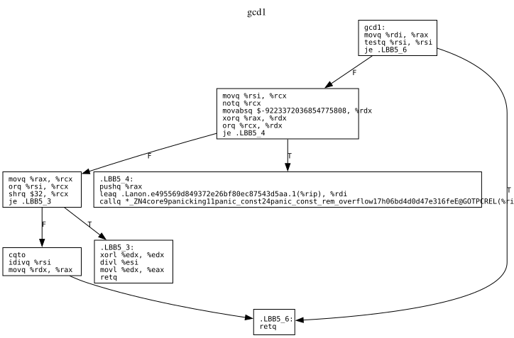

# vis_asm

Visualize the control-flow graph (CFG) of a function in an assembly file
produced by the Go, Julia, OCaml, Rust, or C/C++ compiler (x86-64 or
AArch64), or of a GPU function in NVIDIA PTX.

Given the function name as it appears in the source code, `vis_asm` writes a
DOT file and renders an SVG of the CFG.

## Install (venv recommended)

```
python3 -m venv venv
. venv/bin/activate
pip install --upgrade git+ssh://git@github.com/taura/vis_asm
```

## Example

CFG of the `gcd1` function as compiled by `rustc`:



Reproduce with:

```bash
vis-asm examples/rs/template.s gcd1
```

## Requirements

- Python >= 3.8
- [Graphviz](https://graphviz.org/) — the `dot` binary must be on `PATH`
- *(optional)* `ipython`, for inline rendering inside a Jupyter notebook

## Install

```bash
pip install .
```

With inline Jupyter support:

```bash
pip install '.[notebook]'
```

## Usage

From the shell:

```bash
vis-asm path/to/template.s Collatz
```

This writes `template_Collatz.dot` and `template_Collatz.svg` next to the
assembly file. Use `-o DIR` to direct the output elsewhere.

From Python, or inside a Jupyter notebook:

```python
from vis_asm import vis_asm
vis_asm("go/template.s", "Collatz")
```

In Jupyter the returned `IPython.display.SVG` renders inline.

## Producing the input assembly

| Compiler | Command                                  |
|----------|------------------------------------------|
| Go       | `go tool objdump -gnu <binary>`          |
| Julia    | `code_native(io, f, types)`              |
| OCaml    | `ocamlopt -S source.ml`                  |
| Rust     | `rustc --emit asm source.rs`             |
| C/C++    | `clang -S source.c` / `gcc -S source.c`  |
| PTX      | `clang -fopenmp --offload-arch=sm_90 --offload-device-only -S source.c` |

## License

MIT — see [LICENSE](LICENSE).
